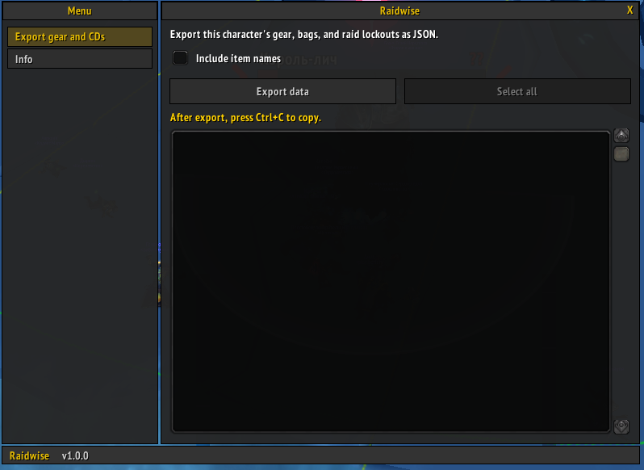

[English](README.md) | [Русский](README.ru.md)

# Raidwise

Raid-prep addon for **Wrath of the Lich King 3.3.5a** (`Interface: 30300`): guild management, party and raid rosters, raid composition checklist, player ratings, meeting history, account-wide lockouts, and character JSON export.


## Install

**Upgrading to 3.0:** replace `Raidwise_EPGP` with `Raidwise_Guild` and fully restart the client. The standalone EPGP page and `/rw guildexport` commands are removed. Old EPGP settings/snapshots are not migrated; guild storage starts fresh. Existing character profiles, encounters, Gear Check reports and other settings are preserved.

**Upgrading from 2.0 to 2.1:** existing profiles and notes are preserved; event
journals migrate automatically to compact change records. Damaged entries are
isolated with their originals retained. `/rw diagnose` reports storage health;
the [storage maintenance guide](docs/characters/Character-System-Contract.md#repairing-quarantined-records) documents repair.

**Upgrading from before 2.0:** back up SavedVariables first. Legacy character profiles,
notes, links, and exchanged data are reset without migration; settings, saved
Gear Check reports, lockouts, and currencies remain. Install the full addon
folder and restart the client because the TOC load order changed.

1. Copy both `Raidwise` and `Raidwise_Guild` folders into your client’s AddOns directory:

   ```text
   <WoW>/Interface/AddOns/Raidwise/
   <WoW>/Interface/AddOns/Raidwise_Guild/
   ```

2. Fully restart the client after installing new files or an updated TOC. Use `/reload` for edits to already loaded files.
3. Enable **Raidwise** and **Raidwise Guild** on the character select AddOns screen if needed. Remove the retired `Raidwise_EPGP` folder when upgrading. Guild tools now share one [roster and journal page](docs/raid/Guild-Management.md); old guild/EPGP data is not migrated.
4. If you previously used **mrc-exporter**, remove that folder from AddOns so only Raidwise loads.


## Releases

Install **Raidwise-vX.Y.Z.zip** from a release.
GitHub's automatic **Source code** archives contain the repository and are not installation packages.
The release ZIP includes both addon folders.

For an explicitly requested release or repair of an existing asset, use the [shared packaging/release guide](tests/README.md#packaging-and-releases).
It explains tagged builds, validation and repair without moving a tag.

## Usage

In-game slash commands:

| Command | Description |
|---------|-------------|
| `/raidwise` or `/rw` | Open the main window |
| `/raidwise close` or `/rw close` | Close the main window |
| `/raidwise gearcheck` or `/rw gearcheck` | Open Gear check (target) and scan |
| `/rw gearcheck summary` (also `items`, `enchants`, `gems`, `ok`) | Print that report to the report chat channel (scans first if needed) |
| `/rw gearcheck raid dump` | Open Raid roster and show the last raid gear-check dump for copy |
| `/rw gearcheck test` | Offline rules self-test |
| `/rw diagnose`, `/raidwise diagnose`, or `/raidwisediag` | Test window opening and gear rules; show a copyable diagnostic report |

Run diagnostics immediately after `/reload`, outside combat, to test fresh window construction. Copy the report with Ctrl+A / Ctrl+C. After installing new Lua files, restart the client with the entire updated `Raidwise` folder. For CLI checks, `npm run diagnose` writes `diagnostics/latest.txt`; see [tests/README.md](tests/README.md).

Plain panels, a **left menu** grouped as Personal / Raiding / Guild / Other, and a content page.
The menu title bar shows **Raidwise** and the addon version.
Esc or the title **X** closes the window.

The draggable minimap button opens **Raid roster** on left-click and **Character cooldowns** on right-click. Hover for raid readiness, consumables, and account-wide character lockouts.

**Guild roster** (Raidwise Guild): search names/notes, filter current-raid groups 1–5 or mains only, and sort EP/GP/PR.
The page provides note/rank editing subject to guild permissions, conflict checks, refresh progress and a local journal with configurable retention.
Guild-info `@BASE_GP` supplies the PR base; minimum EP for roll is a separate per-guild setting (default 4000).
There are 25 records per page, fixed headers and horizontal/vertical scrolling.
See the [guild limits](docs/raid/Guild-Management-Contract.md) for limits and update behavior.

**Character cooldowns** tab:

- Table of raid and dungeon lockouts for every character saved on this account
- First column is the instance name and kind (`(Raid)` / `(Dungeon)`); size and mode live in character cells
- Other columns are characters (class-colored name, spec icon, and last check time); log in on each alt to record them
- **Remove** on non-current character columns drops that alt from the table (login again restores it)
- Saved cells show size/mode tags (`10`, `10h`, `25`, `25h`; heroic in red); hover for time until reset
- **Currency** row at the bottom: labels with account totals in the first column; each character column shows icon + quantity for gold, emblems, honor/arena, and other tokens (from the in-game Currency tab)

**Export gear and CDs** tab:

- Short description, then **Include item names**
- **Export character data** fills the JSON box (name, class, spec, gearScore, gear, bags, lockouts)
- **Select all** highlights the JSON for Ctrl+C
- `gearScore` comes from the **GearScore** addon when it is installed (optional dependency)

**Raid roster** tab:

- Two blocks: raid groups **1–5**, then **6–8**; when not in a raid, your party fills group 1
- Lines above the grid: compact header (S·A·B·C·D chips, GS and role counts, flask/food/gems/armor/weapons/enchants with report icons, Scan/Export/Refresh/Back icons); then scan status and progress
- Each player card: class + name, flask/food status icons, role + spec + GS/iLvl, the saved opinion, separate gem/armor/weapon/enchant grades, **Gear** / **Rescan**, and sword/gem report icons
- Sword/gem icons post that player's gear/weapon or gem/enchant findings to the configured report channel, always in short form (`CODE - slot,slot; CODE - slot`); hover previews the message
- A successful full scan shows its completion date and time with the success message; individual rescans do not change that timestamp
- Hover a card for selected opinion, **guild (rank)**, raid buffs, and gear-check details
- **Scan** / **Export all** for raid-wide gear check; **Export all** opens a compact item list; **Full export** adds overall/item grades, enchantments and sockets (a heavier operation); **Back to roster** closes it; click the dump + Ctrl+C to copy
- **Refresh** re-scans GearScore and re-inspects nearby members for spec icons
- Card click opens **Character profile**

**Raid composition** tab:

- Checklist of the current party or raid (solo uses only you)
- Detected specialization icons and counts appear beneath each class; hover lists the players
- Top band: **Roles** and all 10 **Classes** with counts; then sections: Aggro, buffs, external buffs, damage reduction, debuffs, mana regeneration, health regeneration
- Gold rows are covered; dim rows are missing. Section titles show present/total (red when nothing in the section is present)
- Hover a row for who has it and which class/spec brings which spell; **Shift-click** posts that effect to the report chat channel (header)
- **Report missing** posts absent classes to the report chat channel (header); **Refresh** re-reads the group (same inspect path as Raid roster)
- Effect catalog owner and coverage limits: [composition task map](docs/raid/Raid-Composition.md)
- Reports preview their output; effect reports include clickable spell links and fit one 255-byte chat message.

**Gear check (target)** tab:

- **Scan** evaluates target or self (Overall S / A / B / C / D, class/spec icons, GS/iLvl, findings by filter: All / Items / Enchants / Gems / B)
- Spec ranks: **preferred** / **acceptable** / **unwanted** / **forbidden** (map to A / B / C / D). **S** = equipped item ID is on published BiS lists for that spec (not a unique pick)
- **Report …** buttons and `/rw gearcheck summary|items|enchants|gems|ok` print to the **report chat channel** (header; default Auto = raid/party)
- Report buttons show icons and previews; summaries list all grade counts, and gem reports group warnings by theme without gem IDs.
- **Show as a text** toggles the raw dump; **Save report** keeps a snapshot (~14 days)
- **Character profile** opens the scanned player's profile; target scans do not create group-meeting History entries
- Surface-level disclaimer; development owners and checks: [Gear Check task map](docs/gear-check/Gear-Check-Progress.md). [Catalog maintenance](docs/gear-check/Gear-Check-Surface-From-BiS.md) covers investigating false positives.
- `/rw gearcheck` opens this tab and scans; `/rw gearcheck test` runs the offline self-test

**History** shows this character's group/raid meetings from the last 14 days.
Target scans do not create meetings. Old details expire while counters remain.

**Character database** lists meaningfully filled profiles, including a private
Note or an explicit neutral opinion. Name/target addition opens an empty Profile.
Both lists offer search, 25-row pages and direct access to the same Profile.

**Profile** opens a compact Overview with the three latest events, private Note,
meeting summary and linked characters colored by class. Opinion and selected
roles remain in the header; **Edit** expands their controls. **Events**, **Meetings**
and **Characters** provide details; the change journal opens separately with Back
and independent pagination. **To note** returns to Overview and focuses the Note.
There are 22 event types with categories/search; selecting a type prepares the
entry and explicit confirmation captures its date/place and author. Linked alts
keep separate opinions and Notes; link search appears on demand. **Actions**
contains GUID and confirmed deletion. One-second autosave remains; Save/Retry and
Reload appear when needed. Failed drafts survive closing within the session.
Self-rating is unavailable, but a private Note about oneself is allowed.

Friends, ignore, inbox, guild, chat and tooltips display the chosen explicit opinion
regardless of its author. A Note/scan alone creates no neutral marker. Negative
chat keeps item/achievement links and their colors. One tooltip visibility toggle
controls the opinion line.

Profile exchange, its menus/pages, and Karma are disabled pending future work.
Gear/currency/lockout export remains available. Full profile deletion clears the
opinion, facts, events, Note, changes and links but preserves meetings/counters.
For development use the [character task map](docs/characters/Reputation.md);
[storage constraints/repair](docs/characters/Character-System-Contract.md) and
[manual checks with dated evidence](docs/characters/Character-System-Verification.md) are separate references.
Current manual checks are linked from the character task map;
[November measurements](docs/audits/Audit-2026-11-06-Evidence.md) are historical evidence.

Report controls in the shared header:

- **Report chat channel**: where Raid roster, Composition, and Gear check reports are posted (`RaidwiseDB.reportChannel`; default Auto = raid in a raid, party in a party)
- **Gear check report form**: Short (default, fewer chat lines) or Full detailed wording (`RaidwiseDB.reportForm`)
- Channel radios appear only on Raid roster, Raid composition, and Gear check (target); Short / Full appears only on Gear check (target). Channel labels use chat colors.

**Settings** tab:

- Copyable repository changelog link with **Select all**

- Interface language: **English** or **Русский**
- The choice is saved on this account (`RaidwiseDB.locale`); a Russian client defaults to Russian
- **Theme** category: switch between light and dark; saved per account in `RaidwiseDB.theme`
- **Startup page**: which left-menu tab opens on `/raidwise` (`RaidwiseDB.startupTab`; default Character cooldowns; **Info** cannot be selected)
- **Window**: optionally hide the main window when entering combat (`RaidwiseDB.hideInCombat`, off by default). The title-bar minus button collapses/expands the main window.
- Unit tooltip option: hide selected opinion (`RaidwiseDB.tooltip`)
- Preview of compact (live) and stacked tooltip layouts

The minimap button position is saved in `RaidwiseDB.minimapAngle`.

**Info** tab:

- About overview (one sentence per line, with lists) plus per-menu feature sections (same icons as the left menu, each with that view’s layout `vN`)
- Repository URL in a copy box with **Select all** (Ctrl+C)

UI owners and layout versions: [`docs/ui/UI-Views.md`](docs/ui/UI-Views.md).
Geometry owners and outer sizes: [`docs/ui/UI-Sizes.md`](docs/ui/UI-Sizes.md).
Character task map: [`docs/characters/Reputation.md`](docs/characters/Reputation.md).
Composition navigation and limits: [`docs/raid/Raid-Composition.md`](docs/raid/Raid-Composition.md).

Consumers can type the Export-tab JSON with `types/CharacterExport.ts`. `types/CooldownsExport.ts` describes the account-wide cooldown JSON shape (from `FormatCooldownsExport`; not wired to a UI button yet). `types/GearCheck.ts` describes the Gear Check normalized report (`schemaVersion` 3).

## Screenshots

Main addon view (`/raidwise`):



# Development

## Layout

Use the task maps to find the owner and its checks; the TOCs own the executable
file list. Detailed source catalogs are not duplicated here.

| Work | Start here |
|---|---|
| Code ownership and focused searches | [Architecture](docs/Architecture.md) |
| Installable core / guild load order | [Raidwise.toc](Raidwise/Raidwise.toc), [Raidwise_Guild.toc](Raidwise_Guild/Raidwise_Guild.toc) |
| UI/page changes and geometry | [UI task map](docs/ui/UI-Views.md), [geometry owners](docs/ui/UI-Sizes.md) |
| Behavior checks, diagnostics and benchmarks | [tests README](tests/README.md) |
| JSON/model contracts | [CharacterExport](types/CharacterExport.ts), [CooldownsExport](types/CooldownsExport.ts), [GearCheck](types/GearCheck.ts) |
| Catalog/profile/BiS maintenance | [maintenance guide](docs/gear-check/Gear-Check-Surface-From-BiS.md) |
| Requested release / installable ZIP | [packaging guide](tests/README.md#packaging-and-releases), [bump procedure](.agents/skills/bump/SKILL.md) |

## Notes

- Target: WoW **3.3.5a**, `Interface: 30300`. **GearScore** is optional.
- SavedVariables use `RaidwiseDB` under `WTF/Account/.../SavedVariables/`.
  Legacy `MrcExporterDB` supplies old settings migration input. For current
  storage ownership see [Architecture](docs/Architecture.md#savedvariables-and-versions).
- Character data and saved Gear Check reports support one realm per dataset;
  see [storage limits and repair](docs/characters/Character-System-Contract.md).
- Guild history is local; permission masking does not erase retained data.
  [Guild limits](docs/raid/Guild-Management-Contract.md) explain scope and retention.
- Incomplete scans do not count as ready. Profile exchange is disabled;
  private Notes remain local. Character/cooldown/gear exports have their own
  format contracts, separate from addon semver.

Development setup and checks: [tests/README.md](tests/README.md).
