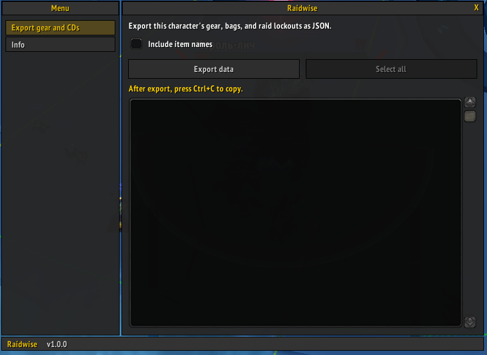

[English](README.md) | [Русский](README.ru.md)

# Raidwise

Raid-prep addon for **Wrath of the Lich King 3.3.5a** (`Interface: 30300`): party and raid rosters, raid composition checklist, player ratings, meeting history, account-wide lockouts, and character JSON export.


## Install

**Upgrading to 2.0:** back up SavedVariables first. Legacy character profiles,
notes, links, and exchanged data are reset without migration; settings, saved
Gear Check reports, lockouts, and currencies remain. Install the full addon
folder and restart the client because the TOC load order changed.

1. Copy the `Raidwise` folder into your client’s AddOns directory:

   ```text
   <WoW>/Interface/AddOns/Raidwise/
   ```

2. Fully restart the client after installing new files or an updated TOC. Use `/reload` for edits to already loaded files.
3. Enable **Raidwise** on the character select AddOns screen if needed.
4. If you previously used **mrc-exporter**, remove that folder from AddOns so only Raidwise loads.


## Usage

In-game slash commands:

| Command | Description |
|---------|-------------|
| `/raidwise` or `/rw` | Open the main window |
| `/raidwise close` or `/rw close` | Close the main window |
| `/raidwise gearcheck` or `/rw gearcheck` | Open Gear check (target) and scan |
| `/rw gearcheck summary` (also `items`, `enchants`, `gems`, `ok`) | Print that report to the report chat channel (scans first if needed) |
| `/rw gearcheck raid dump` | Open Raid roster and show the last raid gear-check dump for copy |
| `/rw gearcheck test` | Offline rules self-test |
| `/rw diagnose`, `/raidwise diagnose`, or `/raidwisediag` | Test window opening and gear rules; show a copyable diagnostic report |

Run diagnostics immediately after `/reload`, outside combat, to test fresh window construction. Copy the report with Ctrl+A / Ctrl+C. After installing new Lua files, restart the client with the entire updated `Raidwise` folder. For CLI checks, `npm run diagnose` writes `diagnostics/latest.txt`; see [tests/README.md](tests/README.md).

Plain panels, a **left menu** grouped as Personal / Raiding / Other, and a content page.
The menu title bar shows **Raidwise** and the addon version.
Esc or the title **X** closes the window.

The draggable minimap button opens **Raid roster** on left-click and **Character cooldowns** on right-click. Hover for raid readiness, consumables, and account-wide character lockouts.

**Character cooldowns** tab:

- Table of raid and dungeon lockouts for every character saved on this account
- First column is the instance name and kind (`(Raid)` / `(Dungeon)`); size and mode live in character cells
- Other columns are characters (class-colored name, spec icon, and last check time); log in on each alt to record them
- **Remove** on non-current character columns drops that alt from the table (login again restores it)
- Saved cells show size/mode tags (`10`, `10h`, `25`, `25h`; heroic in red); hover for time until reset
- **Currency** row at the bottom: labels with account totals in the first column; each character column shows icon + quantity for gold, emblems, honor/arena, and other tokens (from the in-game Currency tab)

**Export gear and CDs** tab:

- Short description, then **Include item names**
- **Export character data** fills the JSON box (name, class, spec, gearScore, gear, bags, lockouts)
- **Select all** highlights the JSON for Ctrl+C
- `gearScore` comes from the **GearScore** addon when it is installed (optional dependency)

**Raid roster** tab:

- Two blocks: raid groups **1–5**, then **6–8**; when not in a raid, your party fills group 1
- Lines above the grid: compact header (S·A·B·C·D chips, GS and role counts, flask/food/gems/armor/weapons/enchants with report icons, Scan/Export/Refresh/Back icons); then scan status and progress
- Each player card: class + name, flask/food status icons, role + spec + GS/iLvl, compact `P:`/`K:` ratings, separate gem/armor/weapon/enchant grades, **Gear** / **Rescan**, and sword/gem report icons
- Sword/gem icons post that player's gear/weapon or gem/enchant findings to the configured report channel, always in short form (`CODE - slot,slot; CODE - slot`); hover previews the message
- A successful full scan shows its completion date and time with the success message; individual rescans do not change that timestamp
- Hover a card for selected opinion, **guild (rank)**, raid buffs, and gear-check details
- **Scan** / **Export all** for raid-wide gear check; **Export all** opens copy text; **Back to roster** closes it; click the dump + Ctrl+C to copy
- **Refresh** re-scans GearScore and re-inspects nearby members for spec icons
- Card click opens **Character profile**

**Raid composition** tab:

- Checklist of the current party or raid (solo uses only you)
- Detected specialization icons and counts appear beneath each class; hover lists the players
- Top band: **Roles** and all 10 **Classes** with counts; then sections: Aggro, buffs, external buffs, damage reduction, debuffs, mana regeneration, health regeneration
- Gold rows are covered; dim rows are missing. Section titles show present/total (red when nothing in the section is present)
- Hover a row for who has it and which class/spec brings which spell; **Shift-click** posts that effect to the report chat channel (header)
- **Report missing** posts absent classes to the report chat channel (header); **Refresh** re-reads the group (same inspect path as Raid roster)
- Full tracking list: [`docs/Raid-Composition.md`](docs/Raid-Composition.md)
- Reports preview their output; effect reports include clickable spell links and fit one 255-byte chat message.

**Gear check (target)** tab:

- **Scan** evaluates target or self (Overall S / A / B / C / D, class/spec icons, GS/iLvl, findings by filter: All / Items / Enchants / Gems / B)
- Spec ranks: **preferred** / **acceptable** / **unwanted** / **forbidden** (map to A / B / C / D). **S** = equipped item ID is on published BiS lists for that spec (not a unique pick)
- **Report …** buttons and `/rw gearcheck summary|items|enchants|gems|ok` print to the **report chat channel** (header; default Auto = raid/party)
- Report buttons show icons and previews; summaries list all grade counts, and gem reports group warnings by theme without gem IDs.
- **Show as a text** toggles the raw dump; **Save report** keeps a snapshot (~14 days)
- **Character profile** opens the scanned player's profile; target scans also record that player in History
- Surface-level disclaimer; rules and known false positives: [`docs/Gear-Check-Progress.md`](docs/Gear-Check-Progress.md)
- `/rw gearcheck` opens this tab and scans; `/rw gearcheck test` runs the offline self-test

**History** shows this character's group/raid meetings from the last 14 days.
Target scans do not create meetings. Old details expire while counters remain.

**Character database** lists meaningfully filled profiles, including a private
Note or an explicit neutral opinion. Name/target addition opens an empty Profile.
Both lists offer search, 25-row pages and direct access to the same Profile.

**Profile** has three tabs: Events, History and Characters. Opinion, four role
facts, author, personal meeting count and the local Note stay visible. There are
22 concrete event types with fixed date/place and explicit authors. Linked alts
keep separate opinions. Auto-save runs after one second idle; Save is also
available. A failed draft stays in memory after closing. Self-rating is disabled,
but a private Note about oneself is allowed.

Friends, ignore, inbox, guild, chat and tooltips display the chosen explicit opinion
regardless of its author. A Note/scan alone creates no neutral marker. Negative
chat keeps item/achievement links and their colors. One tooltip visibility toggle
controls the opinion line.

Profile exchange, its menus/pages, and Karma are disabled pending future work.
Gear/currency/lockout export remains available. Full profile deletion clears the
opinion, facts, events, Note, changes and links but preserves meetings/counters.
See [current model](docs/Reputation.md), [contract](docs/Character-System-Contract.md)
and [verification status](docs/Character-System-Verification.md).

Report controls in the shared header:

- **Report chat channel**: where Raid roster, Composition, and Gear check reports are posted (`RaidwiseDB.reportChannel`; default Auto = raid in a raid, party in a party)
- **Gear check report form**: Short (default, fewer chat lines) or Full detailed wording (`RaidwiseDB.reportForm`)
- Channel radios appear only on Raid roster, Raid composition, and Gear check (target); Short / Full appears only on Gear check (target). Channel labels use chat colors.

**Settings** tab:

- Copyable repository changelog link with **Select all**

- Interface language: **English** or **Русский**
- The choice is saved on this account (`RaidwiseDB.locale`); a Russian client defaults to Russian
- **Theme** category: switch between light and dark; saved per account in `RaidwiseDB.theme`
- **Startup page**: which left-menu tab opens on `/raidwise` (`RaidwiseDB.startupTab`; default Character cooldowns; **Info** cannot be selected)
- Unit tooltip option: hide selected opinion (`RaidwiseDB.tooltip`)
- Preview of compact (live) and stacked tooltip layouts

The minimap button position is saved in `RaidwiseDB.minimapAngle`.

**Info** tab:

- About overview (one sentence per line, with lists) plus per-menu feature sections (same icons as the left menu, each with that view’s layout `vN`)
- Repository URL in a copy box with **Select all** (Ctrl+C)

View layouts: [`docs/UI-Views.md`](docs/UI-Views.md). Pixel sizes: [`docs/UI-Sizes.md`](docs/UI-Sizes.md). Reputation model: [`docs/Reputation.md`](docs/Reputation.md). Composition tracking: [`docs/Raid-Composition.md`](docs/Raid-Composition.md).

Consumers can type the Export-tab JSON with `types/CharacterExport.ts`. `types/CooldownsExport.ts` describes the account-wide cooldown JSON shape (from `FormatCooldownsExport`; not wired to a UI button yet). `types/GearCheck.ts` describes the Gear Check normalized report (`schemaVersion` 3).

## Screenshots

Main addon view (`/raidwise`):



# Development

## Layout

```text
Raidwise/
  Raidwise.toc        # addon metadata (Interface 30300)
  Raidwise.lua        # entry point, events, slash commands
  Locale.lua          # English / Russian UI strings and language switch
  PlayerRecords.lua   # core profile drafts and persistence
  PlayerRecordSupport.lua # active catalogs and identity helpers
  PlayerRecordBridge.lua  # screen-facing character API
  PlayerRecordLinks.lua   # reference links and profile deletion
  PlayerEncounters.lua    # personal group/raid sessions
  ProfileEditor.lua       # unified save controller
  ChatReports.lua     # shared final chat message preparation
  CharacterExport.lua # character JSON export (gear, bags, lockouts)
  CharacterLockouts.lua # account-wide lockout snapshots for the cooldowns table
  InspectCoordinator.lua # shared inspect ownership, identity, and deadlines
  PartyRoster.lua     # party / raid member stats for roster views
  RosterRefresh.lua   # coalesced refreshes and shared per-pass roster snapshots
  RaidRoles.lua       # raid role and spec/race buff lookups
  RaidComposition.lua # party/raid buff, debuff, and utility coverage
  RatingPresentation.lua # rating labels, tooltips, and chat marks
  ProfileCharacters.lua # profile Characters tab
  Diagnostics.lua    # runtime checks and independent copy window
  Minimap.lua         # draggable launcher and raid/lockout summary tooltip
  UnitTooltips.lua    # personal/community lines on player unit tooltips
  ClassicOpinionMarkers.lua # native social, inbox and guild opinion marks
  UITheme.lua         # theme palettes and bound colors/text
  UIWidgets.lua       # shared panels, buttons, icons, layout version badges
  RosterWidgets.lua   # roster, rating, and gear presentation helpers
  GearCheckCatalog.lua # enchant / gem seed catalogs
  GearCheckSets.lua   # T9/T10 set-piece ids (informational)
  GearCheckTrinkets.lua # preferred/allowed trinket pools by role
  GearCheckProfiles.lua # class + 30-spec Gear Check profiles
  GearCheckBis.lua    # generated spec BiS item-ID sets (S grade)
  GearCheckRules.lua  # findings, meta activation, and rule revision
  GearCheckReport.lua # report compatibility and scan completeness
  GearCheckGrades.lua # slot, category, and overall grades
  GearCheckExplanations.lua # category tooltips and grade explanations
  GearCheckSelfTest.lua # offline and in-game rule fixtures
  GearCheckCollector.lua # item/gem reads and normalized snapshots
  GearCheckSavedReports.lua # manual save / load / prune (~14 days)
  GearCheck.lua       # scan orchestration and last-report state
  GearCheckReports.lua # gear report formatting and final messages
  GearCheckDump.lua    # text dumps and asynchronous raid export jobs
  PageCooldowns.lua   # Character cooldowns tab
  PageExport.lua      # Export gear and CDs tab
  PageRaid.lua        # Raid roster tab
  PageComposition.lua # Raid composition tab
  PageGearCheckTarget.lua # Gear check (target) tab
  PageHistory.lua     # History and Character database tabs
  ProfileWindow.lua   # Active profile window
  PageSettings.lua    # Settings tab
  PageInfo.lua        # Info tab
  ExporterWindow.lua  # main window shell (menu, title, status, tab wiring)
scripts/
  generate-gear-check-bis.js # union web-app BiS preset IDs → GearCheckBis.lua
docs/
  Architecture.md     # TOC order, layers, SavedVariables, refresh API
  UI-Views.md         # ASCII layouts for each view + layout version table
  UI-Sizes.md         # window / control pixel sizes
  Gear-Check-Progress.md # Gear Check phase board (planned / done / test steps)
  Reputation.md       # current local character model
  Raid-Composition.md # classes/specs tracked by the Raid composition tab
types/
  CharacterExport.ts  # TypeScript types for the Export tab JSON
  CooldownsExport.ts  # TypeScript types for account-wide cooldown JSON shape
  GearCheck.ts        # TypeScript types for Gear Check report + findings
```

## Notes

- Incomplete/unavailable scans remain visibly marked and do not count as ready in raid/minimap summaries; unconfirmed empty sockets require another inspect response before being reported as missing gems.

Offline development checks use TypeScript, Node.js 24, and a Lua 5.1 WebAssembly
runtime: `npm ci --ignore-scripts`, then `npm run check`. See
[tests/README.md](tests/README.md) for test organization, watch mode, and manual CI.

- Target build: **3.3.5a** (private-server style clients use `## Interface: 30300`).
- Saved variables are stored in `RaidwiseDB` (`WTF/Account/.../SavedVariables/`). Settings from the old `MrcExporterDB` are migrated on first load. Per-character lockouts and currency snapshots for the cooldowns table live in `RaidwiseDB.characters` (`.lockouts`, `.currency`). The character system lives in `RaidwiseDB.playerRecords`; old profile roots are retired without review migration. Interface language is `RaidwiseDB.locale` (`enUS` or `ruRU`). Startup left-menu page is `RaidwiseDB.startupTab`. Unit tooltip visibility flags live in `RaidwiseDB.tooltip`.
- `## X-LastUpdated` in the `.toc` is set manually; keep the README badge in sync.
- Character, cooldown and Gear Check exports retain their format versions. Profile exchange is disabled; private Notes remain local.
- Optional dependency: **GearScore** (`## OptionalDeps`) for the `gearScore` export field.
- Regenerating S-grade BiS IDs: `node scripts/generate-gear-check-bis.js` (reads sibling `Raidwise` web-app presets; see `docs/Gear-Check-Surface-From-BiS.md`).
