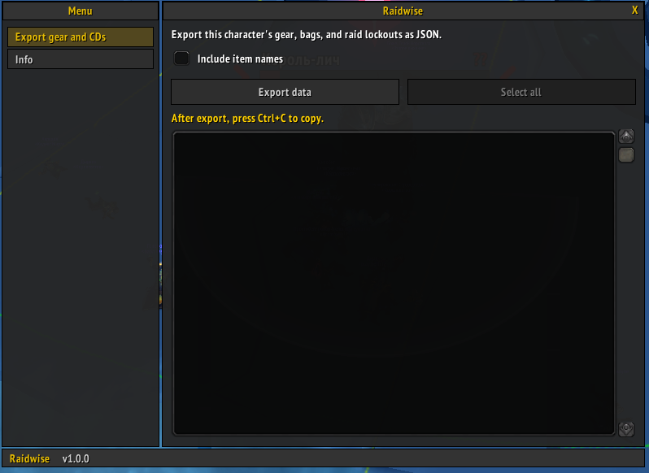

[English](README.md) | [Русский](README.ru.md)

# Raidwise

Аддон для подготовки к рейду в **Wrath of the Lich King 3.3.5a** (`Interface: 30300`): управление гильдией, составы группы и рейда, анализ состава, рейтинг игроков, история встреч, КД на аккаунте и экспорт персонажа в JSON.


## Установка

**Обновление до 3.0:** замените `Raidwise_EPGP` на `Raidwise_Guild` и полностью перезапустите клиент. Отдельная страница EPGP и команды `/rw guildexport` удалены. Старые настройки и снимки EPGP не переносятся; хранилище гильдии начинает работу заново. Профили персонажей, встречи, отчёты Gear Check и остальные настройки сохраняются.

**Обновление с 2.0 до 2.1:** профили и Заметки сохраняются; журналы событий
автоматически переходят на компактное хранение изменений. Повреждённые записи
изолируются с сохранением оригиналов. `/rw diagnose` показывает состояние
хранилища; процедура восстановления — в [контракте](docs/characters/Character-System-Contract.md).

**Обновление с версии до 2.0:** предварительно сохраните копию SavedVariables. Старые
профили, заметки, связи персонажей и данные обмена сбрасываются без переноса;
настройки, отчёты Gear Check, КД и валюты сохраняются. Установите полную папку
аддона и перезапустите клиент: порядок загрузки TOC изменён.

1. Скопируйте папки `Raidwise` и `Raidwise_Guild` в каталог аддонов клиента:

   ```text
   <WoW>/Interface/AddOns/Raidwise/
   <WoW>/Interface/AddOns/Raidwise_Guild/
   ```

2. После установки новых файлов или обновления TOC полностью перезапустите клиент. Для изменений уже загруженных файлов достаточно `/reload`.
3. При необходимости включите **Raidwise** и **Raidwise Guild** на экране выбора персонажа (AddOns). При обновлении удалите старую папку `Raidwise_EPGP`. Гильдейские инструменты объединены на [странице состава и журнала](docs/raid/Guild-Management.md); прежние данные гильдии и EPGP не переносятся.
4. Если раньше стоял **mrc-exporter**, удалите эту папку из AddOns, чтобы загружался только Raidwise.


## Релизы

Для установки скачивайте **Raidwise-vX.Y.Z.zip** из релиза: он содержит обе папки аддонов.
Автоматические архивы GitHub **Source code** содержат репозиторий и не являются установочным пакетом.

Для явно запрошенного выпуска или восстановления существующего ZIP используйте [общее руководство](tests/README.md#packaging-and-releases): сборка из тега, проверки и замена пакета без перемещения тега описаны в одном месте.

## Использование

**Состав гильдии** (Raidwise Guild): поиск по имени и заметкам, фильтры текущего рейда (группы 1–5) и «Только мейны», сортировка EP/GP/PR. Доступны редактирование заметок и званий с проверкой прав и конфликтов, прогресс обновления и локальный журнал с настраиваемым лимитом. База PR берётся из `@BASE_GP` в информации гильдии; минимум EP для ролла — отдельная настройка на гильдию, по умолчанию 4000. На странице 25 записей, закреплённые заголовки и прокрутка по обеим осям. Ограничения и обновление данных описаны в [контракте гильдейского модуля](docs/raid/Guild-Management.md).

Команды в игре:

| Команда | Описание |
|---------|-------------|
| `/raidwise` или `/rw` | Открыть главное окно |
| `/raidwise close` или `/rw close` | Закрыть главное окно |
| `/raidwise gearcheck` или `/rw gearcheck` | Открыть проверку экипа (цель) и сканировать |
| `/rw gearcheck summary` (также `items`, `enchants`, `gems`, `ok`) | Печать отчёта в канал отчётов (сначала сканирует при необходимости) |
| `/rw gearcheck raid dump` | Открыть состав рейда и показать последний dump проверки экипа рейда для копирования |
| `/rw gearcheck test` | Офлайн self-test правил |
| `/rw diagnose`, `/raidwise diagnose` или `/raidwisediag` | Проверка открытия окна и правил экипировки; отчёт для копирования |

Запускайте диагностику сразу после `/reload`, вне боя, чтобы проверить создание окна. Ctrl+A / Ctrl+C копирует отчёт. После установки новых Lua-файлов перезапустите клиент, предварительно обновив всю папку `Raidwise`. Проверка из CLI: `npm run diagnose`, отчёт — `diagnostics/latest.txt`; подробнее в [tests/README.md](tests/README.md).

Простые панели, **левое меню** (группы Личное / Рейд / Гильдия / Прочее) и страница содержимого.
В заголовке меню — **Raidwise** и версия аддона.
Esc или **X** в заголовке закрывает окно.

Перетаскиваемая кнопка миникарты открывает **Состав рейда** левой кнопкой мыши и **КД персонажей** правой. Подсказка показывает готовность рейда, настои/еду и КД персонажей аккаунта.

Вкладка **КД персонажей**:

- Таблица рейдовых и подземельных КД всех персонажей, сохранённых на этом аккаунте
- Первая колонка — название инстанса и тип (`(Рейд)` / `(Подземелье)`); размер и режим — в ячейках персонажей
- Остальные колонки — персонажи (имя цветом класса, иконка спека и время последней проверки); зайдите на каждого альта, чтобы записать данные
- **Удалить** у колонок персонажей (кроме текущего) убирает данные из таблицы (повторный вход восстанавливает данные)
- В сохранённых ячейках — метки размера/режима (`10`, `10h`, `25`, `25h`; героик красным); наведение показывает время до сброса
- Строка **Валюта** внизу: в первой колонке подписи и сумма по аккаунту; в колонках персонажей — иконка и количество (золото, эмблемы, честь/арена и прочие жетоны)

Вкладка **Экспорт экипировки и КД**:

- Краткое описание, затем **Включать названия предметов**
- **Экспорт персонажа** заполняет JSON (name, class, spec, gearScore, gear, bags, lockouts)
- **Выделить всё** выделяет JSON для Ctrl+C
- `gearScore` берётся из аддона **GearScore**, если он установлен (необязательная зависимость)

Вкладка **Состав рейда**:

- Два блока: рейдовые группы **1–5**, затем **6–8**; вне рейда ваша группа занимает слот 1
- Над сеткой: компактная шапка (чипы S·A·B·C·D, GS и роли, настой/еда/камни/броня/оружие/чары с иконкой отчёта, иконки Сканировать/Экспорт/Обновить/К составу); затем статус скана и прогресс
- Карточка: класс + имя, иконки настоя/еды, роль + спек + GS/iLvl, сохранённое мнение, отдельные оценки камней/брони/оружия/чар, **Экип** / **Перескан** и иконки меча/камня для отчётов
- Иконки меча/камня отправляют проблемы экипировки/оружия или камней/чар игрока в выбранный канал отчётов, всегда кратко (`CODE - slot,slot; CODE - slot`); наведение показывает текст сообщения
- После успешного полного скана рядом с сообщением о завершении показаны дата и время; перескан отдельного игрока не меняет эту отметку
- Наведение: выбранное мнение, **гильдия (ранг)**, рейд-баффы, детали gear check
- **Сканировать** / **Экспорт всех** для проверки экипа рейда; **Экспорт всех** открывает компактный список предметов; **Полный экспорт** добавляет общую оценку, оценки предметов, чары и сокеты (более тяжёлая операция); **К составу** закрывает его; клик по тексту + Ctrl+C копирует
- **Обновить** заново считывает GearScore и осматривает ближайших игроков
- Клик по карточке открывает **Профиль персонажа**

Вкладка **Анализ состава**:

- Чеклист текущей группы или рейда (вне группы — только вы)
- Под классами показаны иконки и количество обнаруженных специализаций; наведение перечисляет игроков
- Сверху: **Роли** и все 10 **Классов** со счётчиками; ниже разделы: Аггро, баффы, внешние баффы, снижение урона, дебаффы, восполнение маны, восполнение здоровья
- Золотые строки уже есть, серые — не хватает. В заголовке секции — сколько есть / всего (красный, если в секции ничего нет)
- Наведите на строку: кто даёт эффект и какой класс/спек какое заклинание; **Shift+клик** пишет эффект в канал отчётов (шапка окна)
- **Сообщить** — отсутствующие классы в канал отчётов (шапка окна); **Обновить** заново считывает группу (тот же осмотр, что у состава рейда)
- Подсказки показывают текст отчёта; отчёты эффектов содержат ссылки на заклинания и помещаются в одно сообщение до 255 байт.
- Владельцы каталога эффектов и ограничения: [карта состава](docs/raid/Raid-Composition.md)

Вкладка **Проверка экипа (цель)**:

- **Сканировать** оценивает цель или вас (итог S / A / B / C / D, иконки класса/спека, GS/iLvl, находки по фильтрам: Все / Предметы / Чары / Камни / B)
- Ранги спека: **preferred** / **acceptable** / **unwanted** / **forbidden** (соответствуют A / B / C / D). **S** = ID предмета есть в опубликованных BiS-списках спека (не уникальный выбор)
- Кнопки **Отчёт …** и `/rw gearcheck summary|items|enchants|gems|ok` печатают в **канал отчётов** (шапка окна; по умолчанию Авто = рейд/группа)
- Кнопки отчётов имеют иконки и превью; сводка показывает количество всех оценок, а проблемы камней сгруппированы по теме без ID.
- **Показать текстом** — сырой dump; **Сохранить отчёт** — снимок (~14 дней)
- Владельцы и проверки: [карта Gear Check](docs/gear-check/Gear-Check-Progress.md). Разбор ложных срабатываний — в [обслуживании каталогов](docs/gear-check/Gear-Check-Surface-From-BiS.md).
- `/rw gearcheck` открывает вкладку и сканирует; `/rw gearcheck test` — офлайн self-test

**История** показывает встречи в группах/рейдах за последние 14 дней для текущего
персонажа. Скан цели не создаёт встречу. Старые подробности очищаются, счётчики
сохраняются. **База** хранит заполненные профили; достаточно Заметки или явного
нейтрального мнения. Добавление имени/цели открывает пустой Профиль.

**Профиль** открывается компактным «Обзором»: три последних события, приватная
Заметка, сводка встреч и связанные персонажи с окраской имён по классу. Мнение
и выбранные роли видны в шапке; «Изменить» раскрывает редактор. Разделы «События»,
«Встречи» и «Персонажи» показывают подробности; журнал изменений открывается
отдельно с возвратом и независимыми страницами. «К заметке» открывает Обзор
и фокусирует поле. Выбор из 22 типов событий поддерживает категории и поиск;
дата/место фиксируются при явном подтверждении добавления. У связанных персонажей
свои мнения и Заметки; поиск связей раскрывается по запросу. GUID и удаление
с подтверждением доступны в «Действиях». Автосохранение — через секунду;
«Сохранить»/«Повторить» и «Перечитать» появляются при необходимости. При ошибке
черновик остаётся в памяти после закрытия. Самооценка недоступна, Заметка о себе
разрешена.

Маркеры в чате, подсказках, друзьях, игноре, почте и гильдии показывают выбранное
мнение независимо от автора. Одна Заметка/скан не создаёт нейтральную отметку.
Карма и весь обмен профилями отключены; экспорт экипировки/валют/КД остаётся.
Полное удаление очищает профиль, Заметку, журнал и связи, сохраняя встречи/счётчики.
Для разработки: [карта системы персонажей](docs/characters/Reputation.md),
[ограничения хранения и восстановление](docs/characters/Character-System-Contract.md),
[ручные проверки и датированные свидетельства](docs/characters/Character-System-Verification.md).
[Ноябрьские измерения](docs/audits/Audit-2026-11-06-Evidence.md) — исторические данные.

Управление отчётами в шапке окна:

- **Канал отчётов**: куда пишутся отчёты состава рейда, анализа состава и проверки экипа (`RaidwiseDB.reportChannel`; по умолчанию Авто = рейд в рейде, группа в группе)
- **Форма отчёта проверки экипа**: Короткая (по умолчанию, меньше строк в чат) или Полная (`RaidwiseDB.reportForm`)
- Выбор канала виден только в составе рейда, анализе состава и проверке экипа; Short / Full — только в проверке экипа. Подписи каналов окрашены цветами чата.

Вкладка **Настройки**:

- Ссылка на changelog в репозитории с кнопкой выделения для копирования

- Категория **Тема**: светлая или тёмная, сохраняется на аккаунте в `RaidwiseDB.theme`

- Язык интерфейса: **English** или **Русский**
- Выбор сохраняется на аккаунте (`RaidwiseDB.locale`); на русском клиенте по умолчанию русский
- **Стартовая страница**: какая вкладка левого меню открывается по `/raidwise` (`RaidwiseDB.startupTab`; по умолчанию КД персонажей; **Справку** выбрать нельзя)
- **Окно**: скрытие главного окна при входе в бой (`RaidwiseDB.hideInCombat`, по умолчанию выключено). Кнопка «−» в заголовке сворачивает и разворачивает главное окно.
- Переключатели строк в подсказках игроков: скрыть выбранное мнение (`RaidwiseDB.tooltip`)
- Превью компактного (живой) и столбикового варианта подсказки

Позиция кнопки миникарты сохраняется в `RaidwiseDB.minimapAngle`. При отрицательном личном мнении текст сообщения и маркер `<Rw>` красные; ссылки на предметы и достижения сохраняют исходные цвета. При положительном/нейтральном мнении маркер остаётся мятным/лавандовым с белыми скобками, текст — цвета канала.

Вкладка **Справка**:

- Краткий обзор (одно предложение на строку, со списками) и блоки по пунктам меню (те же иконки, у каждого свой layout `vN`)
- URL репозитория в поле копирования с кнопкой **Выделить всё** (Ctrl+C)

Владельцы UI и layout-версии: [карта интерфейса](docs/ui/UI-Views.md).
Геометрия: [размеры и владельцы](docs/ui/UI-Sizes.md).
Персонажи: [карта задач](docs/characters/Reputation.md).
Состав рейда: [владельцы и ограничения](docs/raid/Raid-Composition.md).

Потребители могут типизировать JSON вкладки Export через `types/CharacterExport.ts`. `types/CooldownsExport.ts` описывает форму JSON КД аккаунта (`FormatCooldownsExport`; пока без кнопки в UI). `types/GearCheck.ts` — нормализованный отчёт Gear Check (`schemaVersion` 3).

## Скриншоты

Главное окно (`/raidwise`):



# Разработка

## Структура

Владельцев и проверки ищите через карты задач; исполняемый список файлов
задают TOC. Полный каталог исходников здесь не дублируется.

| Задача | Откуда начать |
|---|---|
| Владельцы модулей и точечный поиск | [Architecture](docs/Architecture.md) |
| Порядок загрузки core / guild | [Raidwise.toc](Raidwise/Raidwise.toc), [Raidwise_Guild.toc](Raidwise_Guild/Raidwise_Guild.toc) |
| Страницы UI и геометрия | [карта UI](docs/ui/UI-Views.md), [размеры и владельцы](docs/ui/UI-Sizes.md) |
| Тесты, диагностика и бенчмарки | [tests README](tests/README.md) |
| Контракты JSON и моделей | [CharacterExport](types/CharacterExport.ts), [CooldownsExport](types/CooldownsExport.ts), [GearCheck](types/GearCheck.ts) |
| Каталоги, профили и BiS | [обслуживание данных](docs/gear-check/Gear-Check-Surface-From-BiS.md) |
| Запрошенный релиз / установочный ZIP | [руководство сборки](tests/README.md#packaging-and-releases), [процедура bump](.agents/skills/bump/SKILL.md) |

## Заметки

- Целевой клиент: WoW **3.3.5a**, `Interface: 30300`. **GearScore** необязателен.
- SavedVariables хранятся в `RaidwiseDB` под `WTF/Account/.../SavedVariables/`.
  Старый `MrcExporterDB` используется как вход переноса настроек. Владельцы
  текущего хранения — в [Architecture](docs/Architecture.md#savedvariables-and-versions).
- Данные персонажей и сохранённые отчёты Gear Check рассчитаны на один реалм
  в наборе данных: [ограничения и восстановление](docs/characters/Character-System-Contract.md).
- Гильдейская история локальна; скрытие по правам не стирает сохранённые данные.
  Область хранения и retention — в [ограничениях](docs/raid/Guild-Management-Contract.md).
- Неполные сканы не учитываются как готовые. Обмен профилями отключён;
  приватные Заметки остаются локальными. У экспорта персонажа/КД/экипировки
  собственные контракты формата, независимые от semver аддона.

Подготовка окружения и проверки: [tests/README.md](tests/README.md).
